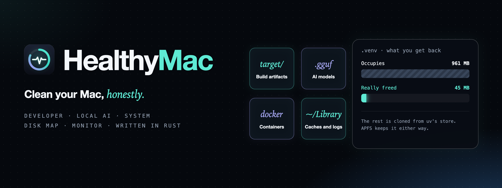
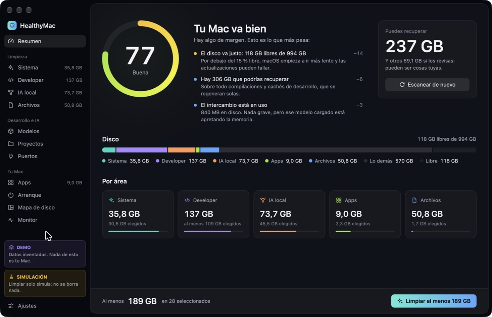
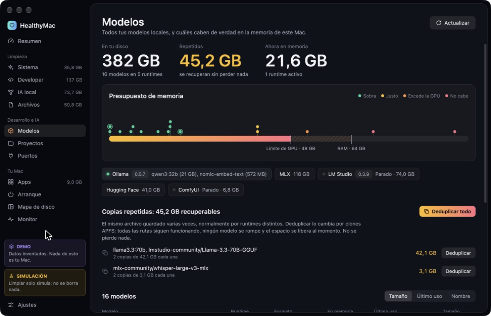
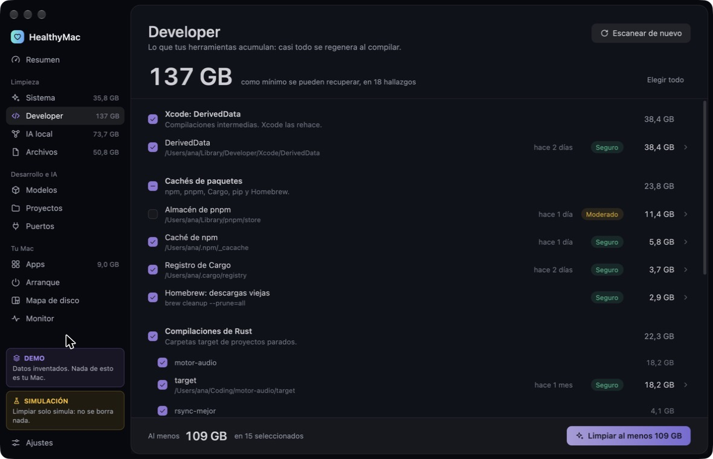
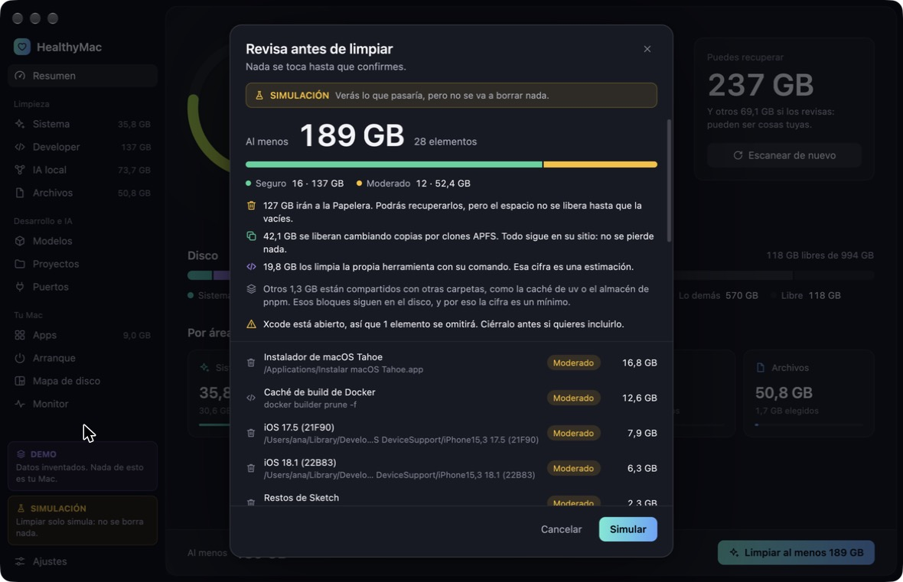
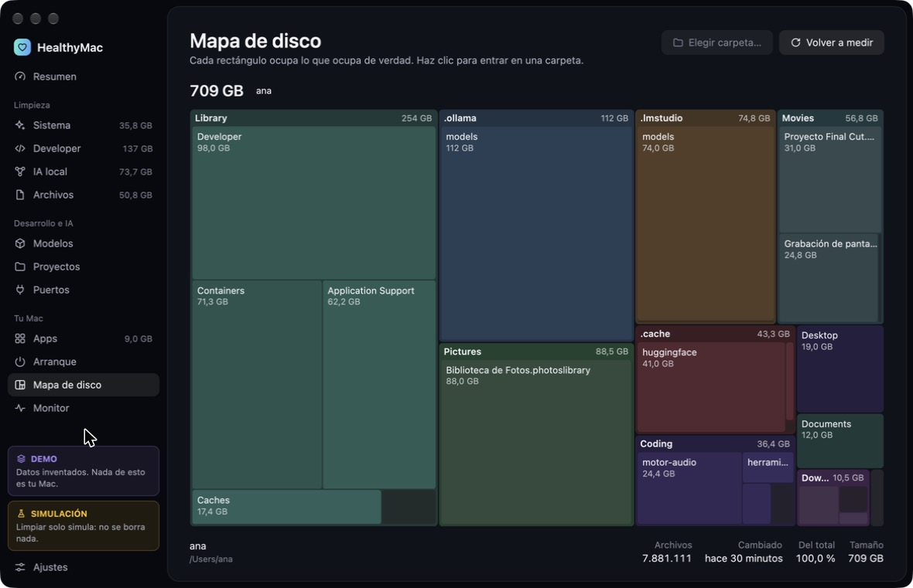
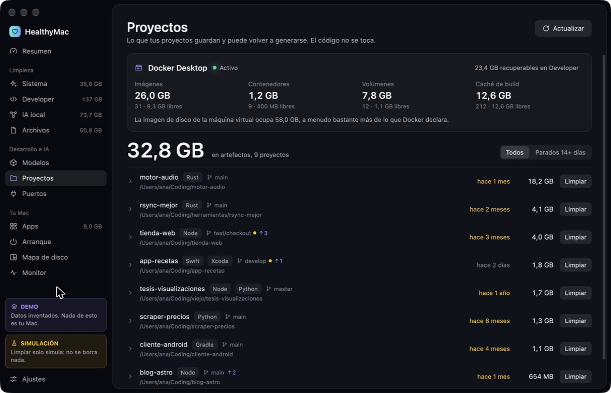
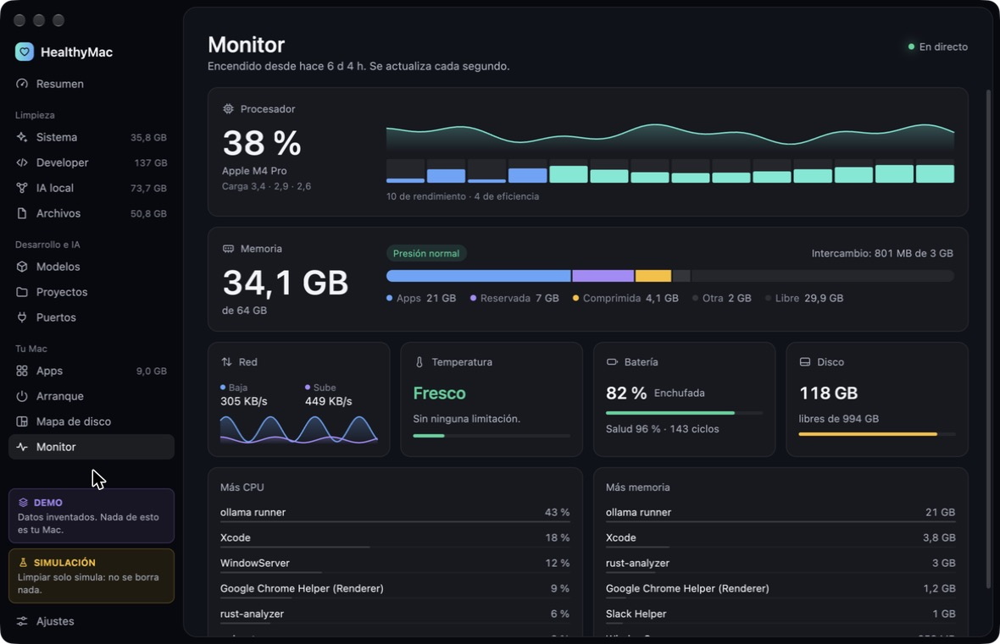

<p align="right"><b>English</b> · <a href="README.es.md">Español</a></p>

<p align="center">
  
</p>

<p align="center">
  <b>See what is really eating your disk and get it back safely.<br>
  HealthyMac knows what APFS clones actually free, understands your build folders and your local AI models,<br>
  and sends everything to the Trash first — a free, open-source alternative to CleanMyMac, written in Rust.</b>
</p>

<p align="center">
  
  
  
  
  
  <br>
  
  
  
  <a href="LICENSE"></a>
</p>

<p align="center">
  <a href="#%EF%B8%8F-install"><b>⬇️ Install</b></a> ·
  <a href="https://github.com/fernandevdaza/HealthyMac/releases"><b>📦 Releases</b></a> ·
  <a href="#%EF%B8%8F-safety"><b>🛡️ Safety</b></a> ·
  <a href="docs/ARCHITECTURE.md"><b>📖 Architecture</b></a> ·
  <a href="#%EF%B8%8F-development"><b>🛠️ Develop</b></a>
</p>

<div align="center">

| **Real sizes** | **14 AI runtimes** | **Trash first** | **662 tests** | **12 MB** |
|:---:|:---:|:---:|:---:|:---:|
| APFS clones and hard links accounted for | one inventory, checked against Metal's memory limit | every path re-checked right before acting | safety, scanners and parsers | ~1% CPU and ~100 MB of RAM at rest |

</div>

> **Nothing leaves your Mac.** No account, no subscription, no telemetry. The only network connections it makes are to
> AI runtimes on `127.0.0.1`, to see what they have loaded.

> [!WARNING]
> **This is an early release, and it deletes things.** Real cleanups have only run on one Mac (M5 Pro, macOS 27). See
> [what has been tested](#-verification), and start with a [simulation](#-quick-start).

---

## ✨ Features

- **Sizes you can trust.** pnpm, uv and bun build their folders from APFS clones of a global store, so a 961 MB `.venv`
  may free just 45 MB. HealthyMac asks APFS which blocks are exclusive, and separates what would be freed from what
  would stay on disk anyway.
- **Local AI, first class.** One inventory for LM Studio, Ollama, Hugging Face, MLX, oMLX, Whisper, llama.cpp, Jan,
  GPT4All, ComfyUI, Automatic1111, Draw Things, Torch Hub and Sentence Transformers: GGUF metadata, what fits in your
  unified memory according to Metal's real limit, abandoned downloads, and which runtimes are running.
- **Dedupe without losing anything.** If two runtimes keep the same weights, it turns them into APFS clones. Every
  program still finds its file, and only the repeated blocks are freed.
- **Made for developers.** Xcode (DerivedData, device support, simulators), build artifacts in any project (`target`,
  `node_modules`, `.venv`, `.terraform`…), package caches (npm, pnpm, Yarn, Bun, Cargo, Go, Gradle, Maven, pip, uv,
  Poetry, Homebrew, CocoaPods…), Docker, toolchains and IDE caches. Active projects are listed but never preselected.
- **Projects and ports.** Your projects with their activity, artifacts and git state, and which process is listening on
  each port, along with the project it belongs to.
- **A system cleaner too.** Caches, logs, leftovers from uninstalled apps, large files, duplicates, old installers, iOS
  backups and Time Machine snapshots.
- **A health score that explains itself.** Every point it takes off comes with the reason.
- **Disk map and monitor.** A navigable treemap, plus CPU, memory, network, temperature, battery and processes.
- **Apps and startup.** Size, leftovers and architecture of each app, an uninstaller, and startup items with the
  orphaned ones flagged.
- **A command line.** `healthymac scan --json` and friends, for scripts.

## 📸 Screenshots

<sub>Demo mode: all the data is made up.</sub>

<table>
  <tr>
    <td colspan="2"><p align="center"><sub><b>Overview</b> · health score with its reasons, disk use by area and what you can recover</sub></p></td>
  </tr>
  <tr>
    <td width="50%"><p align="center"><sub><b>Models</b> · memory budget, running runtimes and repeated copies</sub></p></td>
    <td width="50%"><p align="center"><sub><b>Developer</b> · Xcode, package caches and build folders of idle projects</sub></p></td>
  </tr>
  <tr>
    <td><p align="center"><sub><b>Review</b> · what goes to the Trash, what is freed now and what stays</sub></p></td>
    <td><p align="center"><sub><b>Disk map</b> · click a folder to walk into it</sub></p></td>
  </tr>
  <tr>
    <td><p align="center"><sub><b>Projects</b> · activity, artifacts, git state and Docker</sub></p></td>
    <td><p align="center"><sub><b>Monitor</b> · live CPU, memory, network, temperature and battery</sub></p></td>
  </tr>
</table>

## ⬇️ Install

Needs a Mac with Apple Silicon. In Terminal:

```bash
curl -fsSL https://raw.githubusercontent.com/fernandevdaza/HealthyMac/main/scripts/install.sh | sh
```

That installs the latest release in `/Applications`. Prefer doing it by hand? Download `HealthyMac-mac-arm64.dmg` from
**[Releases](https://github.com/fernandevdaza/HealthyMac/releases)** and drag the app to Applications.

> [!NOTE]
> HealthyMac is signed ad hoc, not notarized: that takes a paid Apple Developer ID. macOS blocks an app like that when
> it was downloaded with a browser. To open it, run `xattr -cr /Applications/HealthyMac.app`, or allow it in
> *System Settings → Privacy & Security*. The Terminal install above doesn't need this.

## 🚀 Quick start

1. Try it with made-up data, where nothing can reach the real cleaner:

   ```bash
   open --env HEALTHYMAC_DEMO=1 /Applications/HealthyMac.app
   ```

2. Scan your Mac in simulation mode. Everything works, but nothing is deleted:

   ```bash
   open --env HEALTHYMAC_DRY_RUN=1 /Applications/HealthyMac.app
   ```

3. Happy with what it found? Open it normally and clean something small first.

Most of it works without special permissions. To also analyze what macOS protects (Documents, Desktop, Downloads, your
photo and video libraries, other apps' data, iOS backups) and to empty the Trash from the app, grant it **Full Disk
Access** in *System Settings → Privacy & Security*.

## 🛡️ Safety

- **Scanners only read.** A single module removes anything, and every path goes through a safety policy right before
  it acts, even if a scanner has a bug.
- **Trash by default.** What goes there can be recovered. What can't be regenerated is never preselected.
- **Hard limits.** It refuses credentials (`~/.ssh`, `~/.gnupg`, `~/.aws`…), synced folders, whole model stores, mount
  points and the folder it runs from. Removing a symlink never touches its target.
- **Commands are allow-listed.** Cleanup commands run directly, without a shell or elevated privileges. These are the
  exception to the Trash, and can't be undone: `docker image prune`, for example.
- **It waits for your apps.** If an IDE is open, its caches are skipped.
- **No surprise permission dialogs.** Scans stay out of protected folders unless you've granted access.
- **Everything is logged** in `~/Library/Logs/HealthyMac/history.jsonl`.

## ✅ Verification

```bash
cargo test --workspace
```

| Crate | Tests | What it checks |
|---|---:|---|
| `hm-system` | 215 | Scanners, permission guards, health score, disk tree, monitor parsers |
| `hm-ai` | 192 | GGUF parsing, model stores, memory fit, duplicates, runtimes |
| `hm-dev` | 154 | Artifact rules and project activity, package caches, Docker, ports |
| `hm-core` | 67 | Safety policy, cleaner, APFS sizes, cloning |
| `hm-app` | 34 | Selection logic, treemap layout |

Two more tests exercise the real Trash, and are ignored by default because they leave tiny files in it.

**Run for real, once, on one Mac** (M5 Pro, macOS 27): moving to the Trash, and cleanup with Docker, Homebrew, npm and
`simctl`.

**Only tested against fixtures:** uninstalling an app, `ollama rm`, Full Disk Access mode, and the Ollama, Jan, GPT4All,
ComfyUI, Automatic1111 and Draw Things stores.

**Not tested:** other macOS versions (it declares 13+) and other Macs. The interface comes in light and dark, and in
English and Spanish; it follows the system unless you pick one in Settings.

## 🛠️ Development

Requirements: stable [Rust](https://rustup.rs) and Xcode. The Metal Toolchain isn't needed: shaders compile at launch.

```bash
cargo run -p hm-app                       # the app, with HEALTHYMAC_DRY_RUN=1 to stay safe
cargo install --path crates/hm-cli        # the `healthymac` command
cargo test --workspace
cargo clippy --workspace --all-targets
scripts/bundle.sh release                 # target/release/HealthyMac.app, signed ad hoc
scripts/package.sh                        # target/release/HealthyMac-mac-arm64.dmg
```

```
crates/
  hm-core/    contract, safety policy, cleaner (the only code that removes), audit log
  hm-system/  system scanners, health score, disk tree, apps, startup, monitor
  hm-dev/     Xcode, build artifacts, package caches, Docker, toolchains, projects, ports
  hm-ai/      model inventory, GGUF, memory fit, duplicates, runtimes
  hm-cli/     the `healthymac` command
  hm-app/     the desktop app, built with GPUI
```

Rules and structure are in [docs/ARCHITECTURE.md](docs/ARCHITECTURE.md) (in Spanish). To catch permission dialogs, launch
the app with `open`: from a terminal, macOS attributes the access to the terminal and the problem doesn't show.

## 🤝 Contributing

Contributions are welcome, especially reports from other Macs and macOS versions, new tools and runtimes, and more
languages. Every user-facing string is written with `t!("español", "English")`; see [docs/ARCHITECTURE.md](docs/ARCHITECTURE.md).
Issues and pull requests in Spanish or English.

## 📄 License

[GPL-3.0-or-later](LICENSE) © 2026 Fernando Daza and contributors.

Built with [Rust](https://www.rust-lang.org) and [GPUI](https://www.gpui.rs) (Apache-2.0).

<sub>CleanMyMac is a trademark of its owner. HealthyMac is an independent project and is not affiliated with it.</sub>
